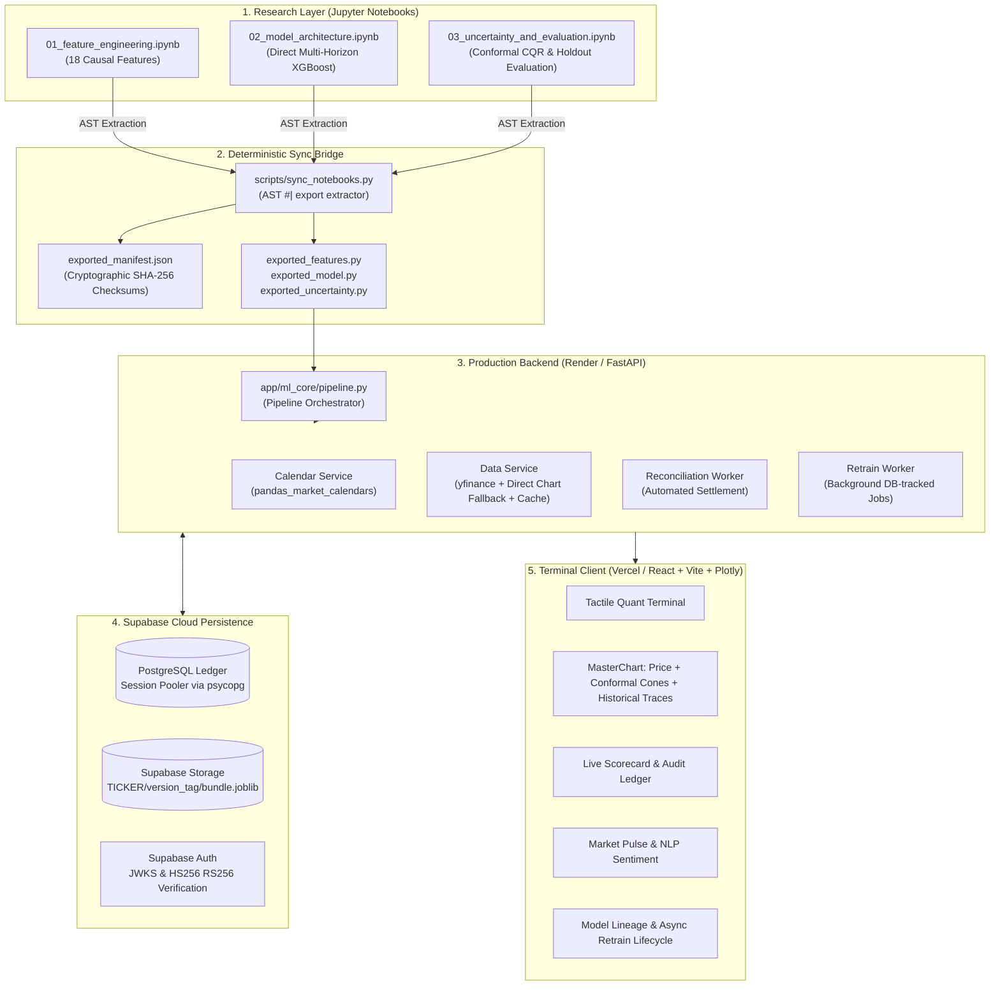

# Log Pose Terminal

> Production-grade multi-horizon equity forecasting terminal with causal feature engineering, split conformal prediction intervals (CQR), and an immutable walk-forward settlement ledger.

---

## 1. System Overview & Engineering Architecture

Log Pose Terminal is an auditable quantitative forecasting platform designed to eliminate the three classic pitfalls of machine learning in financial time series: **lookahead leakage**, **overconfident point estimates**, and **unverifiable backtest claims**.



### Core Architecture Tenets

1. **Notebooks as Single Source of Truth:**
   All machine learning mathematical code, feature equations, loss functions, and conformal bounds are developed inside interactive Jupyter notebooks (`notebooks/*.ipynb`). A static AST parser exports designated cells (`#| export`) into production modules guarded by cryptographic SHA-256 manifests. Direct manual edits to exported production files fail CI verification.
2. **Strict Zero-Lookahead Policy:**
   Features are computed strictly using causal filtration: $X_t = f(\{P_s \mid s \le t\})$. No future information enters rolling estimators, z-score scalers, or volatility estimators. If the market is open when fetching data, the unfinished intraday bar is dropped automatically until the exchange regular session closes. Automated regression tests verify that perturbing $t+1$ market data leaves feature values at $t$ completely unchanged.
3. **Direct Multi-Horizon Forecasting:**
   Rather than compounding prediction errors through autoregressive single-step rollouts, the system fits independent direct estimators for each target trading horizon: $h \in \{1, \dots, H\}$ (where $H$ is up to 20 trading days, default 5). Training only the requested horizon bounds resource usage.
4. **Distribution-Free Uncertainty Quantification (CQR):**
   Point forecasts are paired with adaptive split conformal prediction intervals (`PICP_80` and `PICP_95`). The 80% interval uses Conformalized Quantile Regression (CQR), while the 95% interval uses calibrated absolute residuals. Intervals adapt dynamically to prevailing market volatility and historical residual distributions without parametric Gaussian assumptions.
5. **Immutable Forward-Testing Ledger:**
   Every published prediction is permanently recorded with an anchor timestamp, model version identifier, and point-in-time close price prior to target market sessions. A reconciliation service settles forecasts against realized exchange closes, computing realized MAE, directional accuracy, and interval coverage.

---

## 2. Mathematical Formulation & ML Methodology

### 2.1 The 18 Causal Features

The feature store transforms raw OHLCV price series into exactly 18 normalized, causal features (defined in `exported_features.py`):

| # | Feature Name | Formula / Description |
| :--- | :--- | :--- |
| 1 | `ret_1d` | 1-day log return: $\ln(C_t / C_{t-1})$ |
| 2 | `ret_3d` | 3-day cumulative log return: $\ln(C_t / C_{t-3})$ |
| 3 | `ret_5d` | 5-day cumulative log return: $\ln(C_t / C_{t-5})$ |
| 4 | `ret_10d` | 10-day cumulative log return: $\ln(C_t / C_{t-10})$ |
| 5 | `ret_20d` | 20-day cumulative log return: $\ln(C_t / C_{t-20})$ |
| 6 | `mom_5d` | 5-day rolling mean of 1-day log return |
| 7 | `mom_20d` | 20-day rolling mean of 1-day log return |
| 8 | `vol_parkinson_20d` | 20-day Parkinson High-Low volatility: $\sqrt{\frac{1}{4 \ln 2 \cdot 20} \sum_{i=0}^{19} \ln(H_{t-i}/L_{t-i})^2}$ |
| 9 | `vol_yz_20d` | 20-day Yang-Zhang volatility (overnight + open-to-close + Rogers-Satchell drift-independent component) |
| 10 | `rsi_14` | Wilder-smoothed 14-period Relative Strength Index normalized to $[0, 1]$ via `ewm(alpha=1/14)` |
| 11 | `macd_hist` | MACD histogram normalized by Close: $(EMA_{12}(C) - EMA_{26}(C) - EMA_9(MACD)) / C_t$ |
| 12 | `bb_width` | 20-day Bollinger Band width: $(4 \cdot \sigma_{20}(C)) / SMA_{20}(C)$ |
| 13 | `vol_z20` | 20-day rolling z-score of log volume: $(\ln(1+V_t) - \mu_{20}) / \sigma_{20}$ |
| 14 | `vol_ratio_5_20` | Short-to-medium volatility regime ratio: $\sigma_5(\text{ret\_1d}) / \sigma_{20}(\text{ret\_1d})$ |
| 15 | `vol_ratio_20_60` | Medium-to-long volatility regime ratio: $\sigma_{20}(\text{ret\_1d}) / \sigma_{60}(\text{ret\_1d})$ |
| 16 | `atr_14_pct` | Wilder 14-period Average True Range normalized as percentage of Close: $ATR_{14} / C_t$ |
| 17 | `dow_sin` | Cyclic calendar day-of-week sine encoding: $\sin(2\pi \cdot \text{DOW} / 5)$ |
| 18 | `dow_cos` | Cyclic calendar day-of-week cosine encoding: $\cos(2\pi \cdot \text{DOW} / 5)$ |

*(Note: EMA20/50 price ratios, SPY returns, and rolling beta are intentionally excluded to keep the feature pipeline asset-independent and prevent cross-asset data alignment leakage).*

### 2.2 Quantile Loss & Multi-Horizon Regressors

For each forward step $h \in \{1, \dots, H\}$, point predictions minimize RMSE while lower and upper bounds optimize the pinball loss function across 3 quantiles: $q \in \{0.10, 0.50, 0.90\}$:

$$\mathcal{L}_q(y, \hat{y}_q) = \max\left( q(y - \hat{y}_q), (q - 1)(y - \hat{y}_q) \right)$$

Gradient-boosted decision trees (XGBoost) train direct models per horizon. Quantile monotonicity is strictly enforced post-inference:
$$\hat{y}_{0.10} \le \hat{y}_{0.50} \le \hat{y}_{0.90}$$

### 2.3 Uncertainty Quantification & Split Conformal Prediction (CQR)

To guarantee marginal empirical coverage without assuming Gaussian residuals:
1. **80% Prediction Interval:** Calibrated using Conformalized Quantile Regression (CQR). Nonconformity scores measure the degree to which true prices violate the estimated 10th and 90th quantiles:
   $$E_i = \max(\hat{q}_{0.10}(X_i) - y_i, \, y_i - \hat{q}_{0.90}(X_i))$$
   The conformal adjustment $Q_{1-\alpha}(E)$ expands or contracts the interval:
   $$\hat{C}_{80}(X_{t+h}) = \left[ \hat{q}_{0.10}(X_{t+h}) - Q_{0.80}(E), \; \hat{q}_{0.90}(X_{t+h}) + Q_{0.80}(E) \right]$$
2. **95% Prediction Interval:** Built from calibrated absolute point residuals:
   $$\hat{C}_{95}(X_{t+h}) = \left[ \hat{y}(X_{t+h}) - Q_{0.95}(|y - \hat{y}|), \; \hat{y}(X_{t+h}) + Q_{0.95}(|y - \hat{y}|) \right]$$
   Nesting is strictly enforced: $\hat{C}_{80} \subseteq \hat{C}_{95}$.
3. **Adaptive Conformal Inference (ACI):** When $\ge 20$ live resolved forecasts exist in the ledger, the live empirical 80% coverage feeds into an online feedback loop to adaptively tilt conformal quantile boundaries.

### 2.4 Honest Walk-Forward Validation & Baselines

Walk-forward validation uses expanding splits with purging:
- **Purging:** Training observations whose label window overlaps with test observations are excluded (`train_end + purge <= test_start`).
- **Embargo:** The `embargo` parameter is kept for API compatibility, but is unused in expanding walk-forward splits because folds strictly train on historical data and test on subsequent out-of-sample data.
- **Holdout Conformal Evaluation:** The conformal calibrator is fit on earlier validation folds (e.g., folds 1–6), and true empirical PICP/MPIW coverage metrics are evaluated strictly on unseen holdout folds (folds 7–8).
- **Benchmarked Baselines:** Every model version explicitly tracks:
  - **Always-Up Directional Accuracy:** Directional accuracy of always predicting a positive return.
  - **Zero-Return MAE:** Mean absolute error of predicting zero return ($P_{t+h} = P_t$).

---

## 3. Deployment Architecture

The production stack is deployed across three managed tiers:

```
┌─────────────────────────────────────────────────────────────┐
│                    Vercel (Frontend SPA)                    │
│   React 18 + Vite + Plotly + Tailwind + Vercel Functions    │
│   • Demo banner on backend cold start / downtime            │
│   • Relative routing for /api/sentiment (Vercel serverless) │
└──────────────────────────────┬──────────────────────────────┘
                               │ HTTPS API Requests (120s timeout)
┌──────────────────────────────▼──────────────────────────────┐
│                    Render (Backend API)                     │
│   FastAPI + Uvicorn + Python 3.12 (Free Web Service)        │
│   • Asynchronous background training (returns 202 Job ID)   │
│   • Per-IP rate limiting on expensive mutation routes       │
│   • Background session reconciliation worker                │
└──────────────┬──────────────────────────────┬───────────────┘
               │                              │
┌──────────────▼──────────────┐┌──────────────▼───────────────┐
│     Supabase PostgreSQL     ││       Supabase Storage       │
│   Session Pooler (Port 6543)││   Bucket: model-artifacts    │
│   forecast_run, forecast_pt ││   {TICKER}/{version_tag}/    │
│   retrain_job, model_version││   bundle.joblib              │
└─────────────────────────────┘└──────────────────────────────┘
```

### Cold Starts & Resilience
- **Render Cold Start:** Render free tier instances spin down after inactivity. On initial load, the frontend sends a background ping to `/api/health` and displays a tactile `"Waking up forecasting server…"` indicator. Heavy requests (`/api/forecast`, `/api/retrain`) use a 120-second timeout, while light GETs use a 12-second timeout.
- **Demo Mode Banner:** If the backend is unreachable or waking, the frontend falls back to simulated forecasts marked `is_seeded_demo=true`. A prominent banner warns that predictions are simulated, and mock forecasts are never written to the shared database.
- **Single Source of Truth:** All runs, points, ghosts, and model scores are read exclusively from the backend database. Browser-side mock reconciliation is disabled.

---

## 4. Environment Variables Reference

### Render Backend (Web Service)

| Variable | Description |
| :--- | :--- |
| `ENV` | Environment mode (`production` or `dev`). Must be `production` in live deployments. |
| `DATABASE_URL` | Supabase PostgreSQL transaction/session pooler connection string (`postgresql+psycopg://...`). |
| `SUPABASE_URL` | Supabase project API URL (`https://<project-ref>.supabase.co`). |
| `SUPABASE_JWT_SECRET` | Secret key for verifying HS256 Supabase user JWT tokens. |
| `SUPABASE_SERVICE_ROLE_KEY` | Supabase service-role secret key (backend only) for Storage artifact uploads. |
| `ARTIFACT_BUCKET` | Supabase Storage bucket name for serialized model joblibs (default: `model-artifacts`). |
| `ADMIN_EMAIL` | Email address authorized for administrative actions (e.g. pre-training and sync checks). |
| `SUPPORTED_TICKERS` | Comma-separated list of tickers eligible for on-demand training (default: `AAPL,NVDA,MSFT,SPY,RELIANCE.NS,TCS.NS`). |
| `CORS_ORIGINS` | Comma-separated allowed frontend origins (e.g. `https://log-pose-terminal.vercel.app,http://localhost:5173`). |
| `CORS_ORIGIN_REGEX` | Regular expression for preview deployments (e.g. `^https://.*\.vercel\.app$`). |
| `DEFAULT_HORIZON` | Forward prediction horizon in trading sessions (default: `5`). |
| `MAX_HORIZON` | Maximum forward horizon permitted (default: `20`). |
| `RETRAIN_COVERAGE_FLOOR` | Minimum live coverage floor triggering retrain (default: `0.65`). |
| `RETRAIN_ACTIVATION_COVERAGE` | Minimum validation coverage required to activate a newly retrained model (default: `0.70`). |
| `XGBOOST_N_JOBS` | Thread count for XGBoost training (default: `2`). |

### Vercel Frontend (Project Settings)

| Variable | Description |
| :--- | :--- |
| `VITE_API_BASE_URL` | Full URL to the Render backend ending in `/api` (e.g. `https://log-pose-terminal.onrender.com/api`). |
| `VITE_SUPABASE_URL` | Supabase project URL (`https://<project-ref>.supabase.co`). |
| `VITE_SUPABASE_ANON_KEY` | Supabase public anonymous API key for client-side authentication. |
| `VITE_ADMIN_EMAIL` | Admin email address used to show administrative UI controls in the terminal. |

---

## 5. Local Setup & Quickstart

### 5.1 Installation

```bash
# 1. Clone repository
git clone https://github.com/Artifact19/log-pose-terminal.git
cd log-pose-terminal

# 2. Setup backend virtual environment
python -m venv backend/.venv

# Windows PowerShell:
.\backend\.venv\Scripts\Activate.ps1
# Linux / macOS:
# source backend/.venv/bin/activate

# 3. Install backend dependencies
pip install -r backend/requirements.txt

# 4. Install frontend dependencies
cd frontend
npm install
cd ..
```

### 5.2 Verification & Running Services

```bash
# Verify notebook exports match production code
python scripts/sync_notebooks.py --check

# Run backend unit & integration tests
pytest backend/tests -v

# Start FastAPI backend (port 8000)
uvicorn backend.app.main:app --host 127.0.0.1 --port 8000 --reload

# Start Vite React frontend (port 5173) in a second terminal
cd frontend
npm run dev
```

### 5.3 Automated System Audit
Run the end-to-end audit verifying all 7 production verification checks:
```bash
python scripts/verify_system.py
```

Checks executed:
1. Notebook exports sync check & manifest integrity
2. Active model availability & serialization
3. Backdated forecast generation with causal alignment
4. Idempotent forward reconciliation against actual market closes
5. Live ledger scorecard metric calculations (MAE, Directional Accuracy, Coverage)
6. Model retraining, performance gating, and immutable lineage preservation
7. Methodology drift detection and automated invalidation

---

## 6. Regulatory & Research Disclaimer

**LOG POSE TERMINAL IS FOR RESEARCH AND QUANTITATIVE FORWARD-TESTING PURPOSES ONLY. NOT FINANCIAL ADVICE.**

All forecasts, trajectories, and prediction bands are statistical estimates subject to model error, regime changes, and data vendor outages. Past backtested or forward-tested results do not guarantee future performance.
