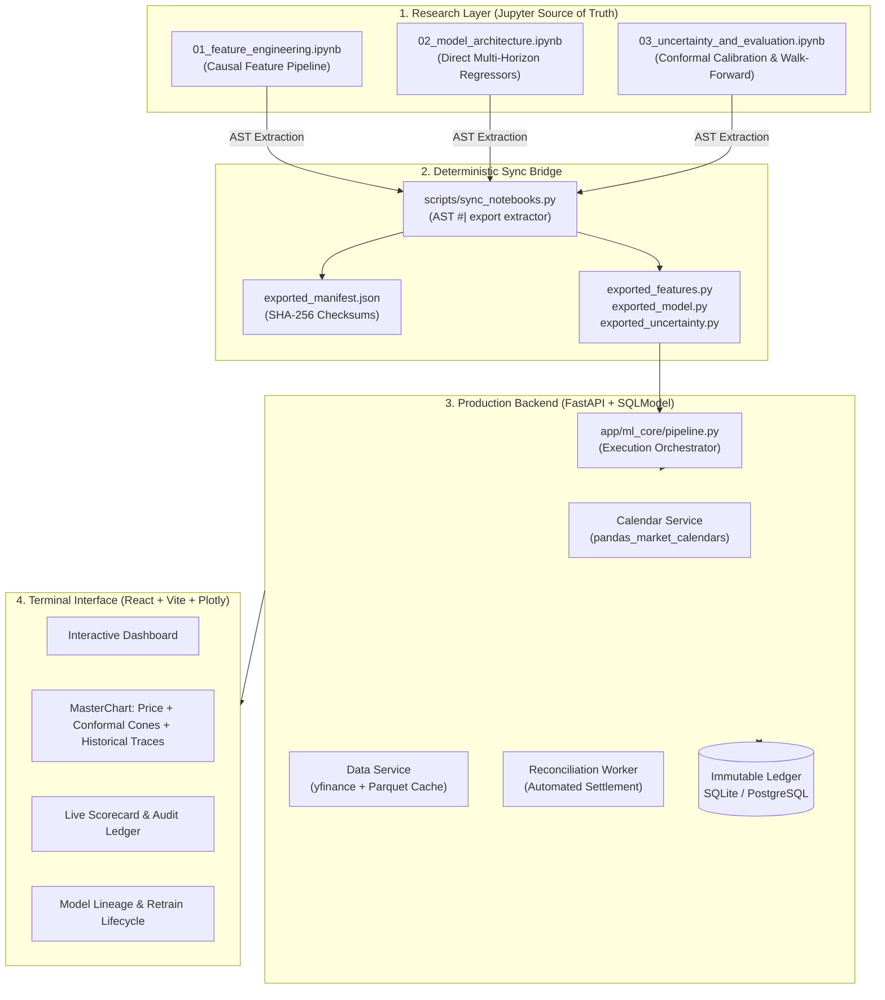
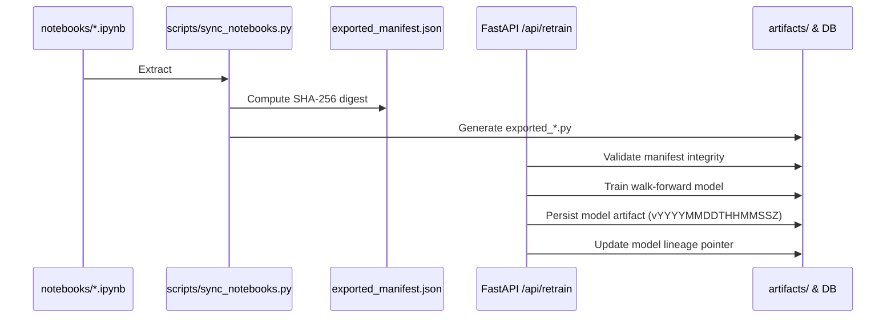

# Log Pose Terminal

> Production-grade multi-horizon equity forecasting system with causal feature engineering, split conformal prediction intervals, and an immutable walk-forward settlement ledger.

---

## 1. System Overview & Core Engineering Principles

Log Pose Terminal is an auditable quantitative forecasting platform designed to solve the three fundamental failure modes of machine learning in financial time series: **lookahead leakage**, **overconfident point estimates**, and **unverifiable backtest claims**.



### Core Architecture Tenets

1. **Notebooks as Single Source of Truth:**
   All machine learning mathematical code, feature formulas, loss functions, and conformal bounds are developed inside interactive Jupyter notebooks (`notebooks/*.ipynb`). A static AST parser exports designated cells (`#| export`) into production modules guarded by cryptographic SHA-256 manifests. Direct edits to exported production files fail continuous integration.
2. **Strict Zero-Lookahead Policy:**
   Features are computed strictly using causal filtration: `X_t = f({P_s | s <= t})`. No future data enters rolling estimators, z-score scalers, or volatility estimators. Automated regression tests verify that perturbing `t+1` market data leaves feature values at `t` completely unchanged.
3. **Direct Multi-Horizon Forecasting:**
   Rather than compounding prediction errors through autoregressive single-step rollouts, the system fits independent direct estimators for each target trading horizon: `h ∈ {1, 2, 3, 5}` trading days.
4. **Distribution-Free Uncertainty Quantification:**
   Point forecasts are paired with adaptive split conformal prediction intervals (`PICP_80` and `PICP_95`). Intervals adapt dynamically to prevailing market volatility and historical residual distributions without parametric Gaussian assumptions.
5. **Immutable Forward-Testing Ledger:**
   Every published prediction is permanently recorded with an anchor timestamp, model version identifier, and point-in-time close price prior to target market sessions. A background worker reconciles forecasts against actual exchange closes, computing realized MAE, directional accuracy, and interval coverage.

---

## 2. Mathematical Formulation & ML Methodology

### 2.1 Causal Feature Engineering

The feature store transforms raw OHLCV price series into a normalized feature matrix:

- **Log Returns:**
  ```text
  r_t = ln(P_t / P_{t-1})
  ```

- **Yang-Zhang Historical Volatility:** Multi-period estimator independent of drift and opening jumps:
  ```text
  σ_YZ² = σ_overnight² + k * σ_open² + (1 - k) * σ_RS²
  where k = 0.34 / (1.34 + (n + 1) / (n - 1))
  ```

- **Technical Momentum & Trend:**
  - Relative Strength Index: `RSI_14(t)`
  - Moving Average Convergence Divergence: `MACD(12, 26, 9)`
  - Exponential Moving Average Ratios: `P_t / EMA_20(t) - 1`, `P_t / EMA_50(t) - 1`
  - Normalized Average True Range: `NATR_14(t) = ATR_14(t) / P_t`

- **Macro Interaction:** Log returns of the benchmark index (`r_SPY,t`) and rolling beta:
  ```text
  β_t = Cov(r_asset, r_SPY) / Var(r_SPY)
  ```

### 2.2 Quantile Loss & Pinball Optimization

For each horizon `h`, point predictions minimize Root Mean Squared Error (RMSE) while probabilistic bounds optimize the pinball loss function for quantile levels `q ∈ {0.10, 0.25, 0.50, 0.75, 0.90}`:

```text
L_q(y, ŷ_q) = max( q * (y - ŷ_q),  (q - 1) * (y - ŷ_q) )
```

Gradient boosted decision tree ensembles (XGBoost) optimize `L_q` directly. Quantile monotonicity is strictly enforced post-inference:

```text
q_0.10 <= q_0.25 <= q_0.50 <= q_0.75 <= q_0.90
```

### 2.3 Split Conformal Prediction

To ensure valid empirical coverage under finite samples without assuming Gaussian residuals, prediction intervals are calibrated using locally weighted split conformal prediction:

1. **Nonconformity Score:**
   ```text
   s_i = |y_i - ŷ_i| / σ_i
   ```
   where `σ_i` is the local volatility proxy (NATR).

2. **Conformal Quantile:**
   For a desired significance level `δ ∈ {0.20, 0.05}` (corresponding to 80% and 95% nominal coverage):
   ```text
   k_(1-δ) = Quantile( 1 - δ,  {s_i | i ∈ D_calib} ) * ((n + 1) / n)
   ```

3. **Calibrated Interval:**
   ```text
   C_(1-δ)(X_t+h) = [ ŷ_t+h - k_(1-δ) * σ_t+h,   ŷ_t+h + k_(1-δ) * σ_t+h ]
   ```

This guarantees marginal empirical coverage:
```text
P( Y_t+h ∈ C_(1-δ)(X_t+h) ) >= 1 - δ
```

### 2.4 Purged Walk-Forward Cross-Validation with Embargo

Time series cross-validation uses expanding walk-forward splits with purging and embargoing:
- **Purging:** Training observations whose forward label window overlaps with test observations are excluded.
- **Embargo:** An embargo period equal to the maximum horizon `h_max = 5` days is placed immediately after test folds to prevent autoregressive information leakage through autoregressive features.

---

## 3. Repository Structure

```text
├── notebooks/                      # Single source of truth for ML math
│   ├── 01_feature_engineering.ipynb          # Causal indicators & zero-lookahead checks
│   ├── 02_model_architecture.ipynb            # XGBoost point & quantile regressors
│   └── 03_uncertainty_and_evaluation.ipynb    # Conformal calibration & walk-forward CV
├── backend/
│   ├── app/
│   │   ├── api/routes/            # REST API (forecast, ledger, models, retrain)
│   │   ├── ml_core/               # Exported modules & AST sync manifest
│   │   │   ├── contracts.py       # Typed interfaces for ML pipelines
│   │   │   ├── exported_*.py      # Auto-generated from notebooks
│   │   │   └── manifest.py        # Cryptographic checksum validator
│   │   ├── models/tables.py       # SQLModel ORM entities (ModelVersion, ForecastRun)
│   │   ├── repositories/          # Data access layer
│   │   └── services/              # Calendar, data ingestion, settlement, retrain
│   └── tests/                     # Test suite (lookahead, purge, conformal, API)
├── frontend/                       # Interactive web terminal
│   ├── src/
│   │   ├── components/            # MasterChart, ForecastTable, Scorecard, ModelOps
│   │   ├── api/client.ts          # Typed REST client
│   │   └── types/index.ts         # TypeScript schema definitions
├── scripts/
│   ├── sync_notebooks.py          # AST extraction bridge (#| export)
│   ├── seed_demo.py               # Database seeder for demo symbols
│   └── verify_system.py           # 8-step end-to-end verification script
├── Makefile                       # Development task automation
└── pytest.ini                     # Pytest environment configuration
```

---

## 4. Quickstart & Installation

### 4.1 Prerequisites
- **Python 3.10+** (Python 3.12 recommended)
- **Node.js 18+** and **npm**
- **Git**

### 4.2 Local Environment Setup

```bash
# Clone the repository
git clone https://github.com/Artifact19/log-pose-terminal.git
cd log-pose-terminal

# Setup Python virtual environment
python -m venv backend/.venv

# Windows Powershell:
.\backend\.venv\Scripts\Activate.ps1
# macOS / Linux:
# source backend/.venv/bin/activate

# Install backend dependencies
pip install -r backend/requirements.txt

# Install frontend dependencies
cd frontend
npm install
cd ..
```

### 4.3 Verify Sync & Seed Database

```bash
# Verify that production code matches notebook source of truth
python scripts/sync_notebooks.py --check

# Seed initial models and historical ghost runs (AAPL, SPY, RELIANCE.NS)
python scripts/seed_demo.py
```

### 4.4 Run Services

#### Terminal 1 — Backend API (FastAPI)
```bash
python -m uvicorn backend.app.main:app --host 127.0.0.1 --port 8000 --reload
```
- Interactive Swagger Documentation: [http://127.0.0.1:8000/docs](http://127.0.0.1:8000/docs)
- Health Check: [http://127.0.0.1:8000/api/health](http://127.0.0.1:8000/api/health)

#### Terminal 2 — Frontend Terminal (Vite + React)
```bash
cd frontend
npm run dev
```
- Web Application: [http://localhost:5173](http://localhost:5173)

---

## 5. Verification & Testing

### 5.1 End-to-End System Audit
Run the automated end-to-end audit verifying all 8 production criteria:
```bash
python scripts/verify_system.py
```

Expected output:
```text
======================================================================
LOG POSE TERMINAL END-TO-END VERIFICATION
======================================================================
[PASS] 1. Notebook Exports Sync Check         | Exports match notebook cells
[PASS] 2. Active Model Available & Valid      | Version: v20261103T151217Z
[PASS] 3. Backdated Forecast Creation         | Anchored run generated
[PASS] 4. Reconciliation & Idempotency        | 5/5 resolved, status=RESOLVED, 2nd run=0 new
[PASS] 5. Live Ledger Scorecard Stats         | Realized MAE, Hit Rate, 80% Coverage computed
[PASS] 6. Retraining & Lineage Immutability   | New version activated, historical artifact intact
[PASS] 7. Methodology Drift Detection         | Checksum drift correctly flagged
======================================================================
OVERALL STATUS: ALL CHECKS PASSED (100%)
======================================================================
```

### 5.2 Unit & Integration Test Suite
```bash
pytest backend/tests -v
```

Test coverage includes:
- `test_lookahead.py`: Strict invariance of historical feature values under future price shocks.
- `test_walkforward_purge.py`: Non-overlapping fold splits with `h_max` embargo verification.
- `test_conformal.py`: Quantile non-crossing (`q_10 <= q_50 <= q_90`) and empirical coverage bounds.
- `test_sync_notebooks.py`: AST cell extraction, checksum calculation, and tamper prevention.
- `test_calendar_alignment.py`: NYSE/NSE session alignment, weekend skipping, and holiday handling.
- `test_reconciliation.py`: Forward settlement against realized prices with idempotency checks.
- `test_api.py`: FastAPI endpoint contracts and error handling.

---

## 6. Model Retraining & Research Lifecycle

To update model architecture or features, follow the research-to-production workflow:



1. **Modify Research Code:** Open `notebooks/` in Jupyter and modify feature formulas or hyperparameter grids within cells marked `#| export`.
2. **Execute Sync Bridge:**
   ```bash
   python scripts/sync_notebooks.py
   ```
3. **Trigger Model Recalibration:**
   ```bash
   curl -X POST http://127.0.0.1:8000/api/retrain \
        -H "Content-Type: application/json" \
        -d '{"ticker": "AAPL", "force": false}'
   ```
   A new model version (`vYYYYMMDDTHHMMSSZ`) is instantiated and evaluated. If walk-forward validation passes performance gates (MAE reduction and nominal interval coverage >= 65%), the new version is activated. Historical versions and binary artifacts remain immutable.

---

## 7. Environment Configuration

| Variable | Default | Purpose |
| :--- | :--- | :--- |
| `DATABASE_URL` | `sqlite:///./ledger.db` | SQLModel database connection string (SQLite or PostgreSQL) |
| `ARTIFACT_DIR` | `./artifacts` | Storage directory for serialized model binaries (`.joblib`) |
| `CACHE_DIR` | `./cache` | Storage directory for Parquet market data cache |
| `DEFAULT_HORIZON` | `5` | Default forward forecast horizon in trading sessions |
| `DEFAULT_TRAIN_YEARS` | `8` | Historical lookback window for model training |
| `RETRAIN_COVERAGE_FLOOR` | `0.65` | Minimum validation coverage required to activate retrained model |
| `CORS_ORIGINS` | `http://localhost:5173` | Allowed CORS origins for frontend client |

---

## 8. Regulatory & Research Disclaimer

**LOG POSE TERMINAL IS FOR RESEARCH AND FORWARD-TESTING PURPOSES ONLY. NOT FINANCIAL ADVICE.**

All forecasts, expected trajectories, and prediction intervals are statistical estimates subject to estimation variance, regime transitions, and data vendor limitations. The platform does not constitute an offer or recommendation to buy or sell securities. Past backtested or forward-tested performance does not guarantee future results.
